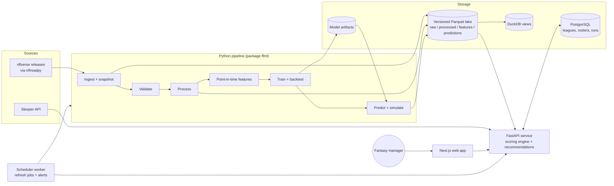
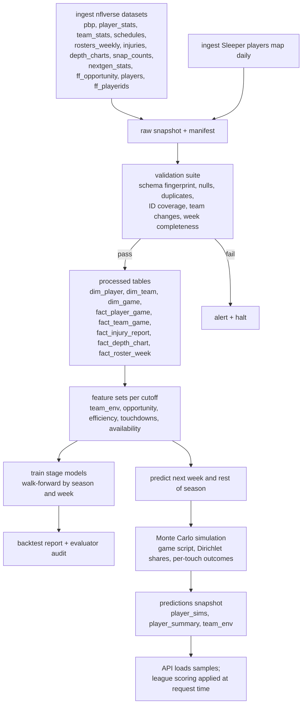
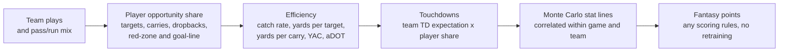
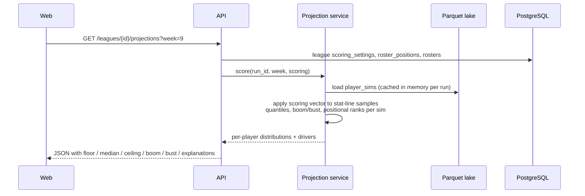
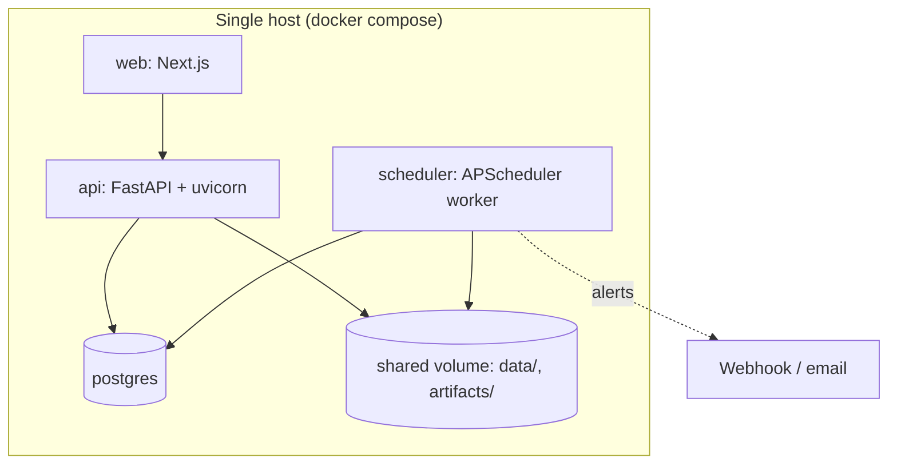

# Architecture

## 1. System context



## 2. Components

| Component | Technology | Responsibility |
| --- | --- | --- |
| `ffml` pipeline | Python 3.11, Polars, DuckDB, PyArrow, scikit-learn, LightGBM, NumPy | ingestion with snapshot manifests, validation suite, processed tables, point-in-time features, baselines and models, walk-forward backtests, Monte Carlo simulation, prediction publishing |
| Parquet lake | Parquet files under `data/` (not in git), `snapshot=` partitions, manifests | reproducible raw and processed data; every run records input snapshot ids |
| DuckDB | single file `data/warehouse.duckdb`, views over latest snapshots | ad-hoc analysis, backtest reporting, feature QA; disposable |
| API | FastAPI, SQLAlchemy 2, Alembic, Pydantic v2 | league import (Sleeper) and manual setup, scoring engine, projection service, start/sit, waivers, trade analyzer, rest-of-season rankings, attribution and model-card endpoints |
| App database | PostgreSQL in deployment and CI; SQLite for local development (same SQLAlchemy models) | leagues, teams, rosters, scoring and roster settings, projection run registry, per-league caches |
| Web | Next.js (App Router), TypeScript, Tailwind CSS, lightweight SVG charts | responsive UI with explanations, empty and error states, offseason mode |
| Scheduler | APScheduler worker container; equivalent GitHub Actions cron workflows | post-game updates, injury and depth-chart refresh, retraining checks, data-quality checks, failure alerts |
| CI/CD | GitHub Actions, Docker, docker compose | lint, unit and integration tests, Playwright end-to-end tests, image builds, fresh-install verification on a clean runner |

## 3. Pipeline DAG



## 4. Model chain (football before fantasy)



Every stage emits a distribution, not a point. The simulation threads shared
game-level draws (pace, pass rate, total, margin) through both teams so that a
QB and WR on the same team move together and opposing defenses pull the other
way. Teammates draw opportunity shares from a Dirichlet around predicted
shares, which gives negative correlation among them. Scoring rules are applied
to the simulated stat lines at request time, so any league configuration works
without retraining. Details are in MODELING.md.

## 5. Request flow for a projection with custom scoring



Sample matrices are small (about 600 players x 2,000 samples x 25 stat
columns per week, roughly 15 MB in Parquet). Scoring is a vectorized dot
product and finishes in milliseconds.

## 6. Deployment topology



Local development runs the API and web app directly (SQLite app database),
with the same Parquet lake on disk. CI runs PostgreSQL as a service container
and verifies a fresh install with docker compose on a clean runner.

## 7. Repository layout

```
fantasy-football-ml/
  pyproject.toml           Python project (ffml + api), pinned dependencies
  ffml/                    pipeline package
    config.py              paths, season/week resolver, run ids
    data/                  nflreadpy wrappers, Sleeper client, snapshot store, validation
    features/              point-in-time feature builders and leakage guards
    models/                baselines, stage models, quantiles, calibration
    sim/                   Monte Carlo engine and scoring-agnostic stat lines
    scoring/               league scoring rules engine (Sleeper map + manual)
    eval/                  backtest harness, metrics, calibration, audits, reports
    cli.py                 ffml ingest | validate | process | features | train | backtest | predict | refresh
  api/                     FastAPI application
    main.py routers/ services/ db/ schemas/ alembic/
  web/                     Next.js application (app/, components/, lib/, tests/)
  tests/                   pytest suites: data, features, models, sim, scoring, api
  reports/                 backtest reports, model card, evaluator sign-offs (committed)
  docs/                    plan, architecture, schema, features, modeling, runbook, deployment, attribution
  docs/status/             agent status notes with evidence
  scripts/                 operational scripts (refresh, alerts, smoke tests)
  .github/workflows/       ci.yml, data_quality.yml, weekly_refresh.yml, injury_refresh.yml, retrain_check.yml
  docker-compose.yml  Dockerfile.api  Dockerfile.web  Dockerfile.pipeline
  data/  artifacts/        gitignored; README files describe layout
```

## 8. Cross-cutting rules

- **Point-in-time discipline.** Every feature row carries a `cutoff_ts`. Builders
  read only rows whose event time is strictly earlier than the cutoff. Leakage
  tests rebuild features from truncated inputs and assert equality.
- **Reproducibility.** Every pipeline run has a `run_id`; its manifest records
  input snapshot ids, git SHA, package versions, random seeds, and metrics.
  Predictions carry `model_version` and `run_id` all the way to the UI.
- **Evaluator independence.** Model and feature code can only be changed by the
  ML and Feature Engineer roles; the Independent Evaluator writes under
  `ffml/eval/`, `tests/eval/`, and `reports/` and must sign off before Phase 4.
- **No placeholder predictions.** The API refuses to start in production mode
  without a published predictions snapshot; the UI shows an explicit empty state.
- **Offseason mode.** When no regular-season game remains, the season/week
  resolver switches the app to season-level rankings with an explanatory banner;
  start/sit is disabled with a reason, waivers and trades use season values.
- **Security.** No secrets in git; `.env.example` documents configuration;
  input validation on every endpoint; Sleeper calls rate-limited and cached;
  CORS allowlist; dependency audits (`pip-audit`, `npm audit`) in CI; security
  headers on the web app.
- **Attribution.** An `/about/attribution` page and an API endpoint list every
  source and license, including FTN-specific wording when FTN features are on.
