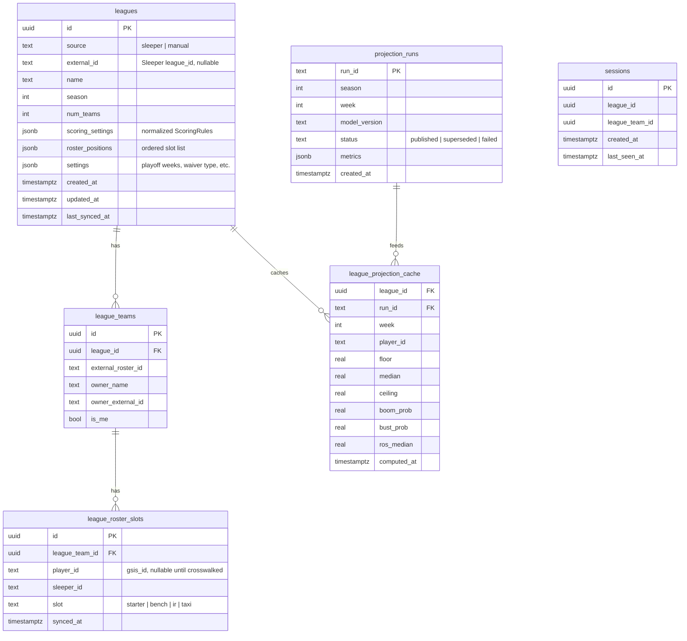

# Data Schema

Three storage tiers: a versioned Parquet lake for everything analytical, a
disposable DuckDB file of views for querying it, and a relational app database
for league state. Player identity everywhere is the nflverse `gsis_id`
(`player_id`), with Sleeper and other IDs carried in `dim_player`.

## 1. Parquet lake layout

```
data/
  raw/<dataset>/snapshot=<YYYYMMDDTHHMMSSZ>/season=<YYYY>/part-0.parquet
  raw/<dataset>/snapshot=<...>/_manifest.json
  raw/<dataset>/LATEST                      text file holding the newest snapshot id
  raw/sleeper_players/snapshot=<YYYYMMDD>/players.parquet
  processed/<table>/snapshot=<...>/season=<YYYY>/part-0.parquet
  processed/<table>/snapshot=<...>/_manifest.json      lists the raw snapshot ids it was built from
  processed/<table>/LATEST
  features/<feature_set>/version=<semver>/season=<YYYY>/part-0.parquet
  predictions/season=<YYYY>/week=<WW>/run=<run_id>/player_sims.parquet
  predictions/season=<YYYY>/week=<WW>/run=<run_id>/player_summary.parquet
  predictions/season=<YYYY>/week=<WW>/run=<run_id>/team_env.parquet
  predictions/season=<YYYY>/week=<WW>/run=<run_id>/_manifest.json
  predictions/LATEST                        json: {season, week, run_id, model_version}
  warehouse.duckdb                          views over LATEST pointers; safe to delete
artifacts/
  models/<model_name>/<model_version>/model.(txt|pkl) params.json features.json metrics.json train_manifest.json
  models/REGISTRY.json                      which versions are candidate / approved / live
```

Manifest fields (raw): `dataset`, `loader`, `loader_kwargs`, `seasons`,
`fetched_at`, `nflreadpy_version`, `rows`, `columns`, `schema_hash`
(SHA-256 of ordered column names and dtypes), `file_sha256`, `source_license`.

Retention: mutable datasets (injuries, depth charts, rosters, schedules,
current-season stats, Sleeper players) keep the last 8 snapshots by default
plus one per completed week forever (needed for point-in-time audits). Past
seasons are deduplicated by `file_sha256`.

## 2. Processed tables

Types are Polars/Arrow. Keys are unique and tested.

### dim_player
| column | type | notes |
| --- | --- | --- |
| player_id | str | gsis_id, primary key |
| full_name, first_name, last_name | str | |
| position | str | fantasy position: QB, RB, WR, TE, K, or the raw value; FB maps to RB; a manual override may force it (D-041) |
| position_raw | str | source position |
| birth_date | date | |
| rookie_season, draft_year, draft_round, draft_pick | int | nullable |
| sleeper_id, espn_id, yahoo_id, pfr_id, fantasypros_id, mfl_id, nfl_id | str | nullable; `sleeper_id` unique when present |
| crosswalk_source | str | ff_playerids, rosters_weekly, sleeper_players, name_match, manual |
| headshot_url | str | |
| latest_team, status, height, weight, college_name | mixed | from the players table |
| last_season, last_active_season | int | used to resolve sleeper_id conflicts |
| updated_at | datetime | |

Manual overrides live in `ffml/data/crosswalk_overrides.csv` (gsis_id, sleeper_id,
espn_id, yahoo_id, position, note) and win over every other source.

### dim_team
`team` (pk, current abbreviation), `team_name`, `team_nick`, `conf`,
`division`, colours, logo URLs, and an `aliases` list column (OAK for LV, SD
for LAC, STL and LAR for LA, JAC for JAX). The alias map itself lives in
`ffml/data/process/base.py` so every fact table uses current codes.

### dim_game
| column | type | notes |
| --- | --- | --- |
| game_id | str | pk, nflverse id such as 2026_09_KC_BUF |
| season, week | int | |
| game_type | str | REG, WC, DIV, CON, SB |
| kickoff_utc | datetime | from gameday + gametime (ET) |
| home_team, away_team | str | current codes |
| home_score, away_score, result, total | int | null until final |
| status | str | scheduled, in_progress, final |
| spread_line, total_line, home_moneyline, away_moneyline | float | as published in the schedule snapshot |
| roof, surface | str | |
| temp, wind | float | actuals in history; treated as sensitivity features only |
| home_rest, away_rest, div_game | int | |
| stadium_id, stadium | str | |

### fact_player_game
One row per player per game for players with a roster slot that week
(QB, RB, WR, TE, K), including those who did not play (`played = false`).
| column group | columns |
| --- | --- |
| keys | player_id, season, week, game_id, team, opponent, position, game_type, home, kickoff_utc |
| participation | played, offense_snaps (null when PFR has no row), offense_pct, row_source (stats or roster); the `started` flag is derived later from fact_depth_chart |
| passing | pass_att, completions, pass_yds, pass_td, interceptions, sacks, sack_yards, pass_air_yards, pass_yac, pass_epa, cpoe, dropbacks |
| rushing | carries, rush_yds, rush_td, rush_first_downs, rush_epa, designed_rush, scrambles (QB) |
| receiving | targets, receptions, rec_yds, rec_td, rec_air_yards, rec_yac, rec_epa, adot, target_share, air_yards_share, wopr |
| situational (from pbp) | rz_targets, rz_carries, gl_carries (inside the 5), ez_targets, third_down_targets, two_min_targets |
| team context (same game, used only for computing shares) | team_pass_att, team_rush_att, team_targets, team_rz_targets, team_rz_carries, team_gl_carries, team_pass_td, team_rush_td, team_plays |
| expected (ffopportunity) | rec_yards_exp, rec_td_exp, receptions_exp, rush_yards_exp, rush_td_exp, pass_yards_exp, pass_td_exp, total_fp_exp |
| nextgen (nullable) | avg_separation, avg_cushion, yac_above_expectation, avg_intended_air_yards, time_to_throw, aggressiveness, rush_yards_over_expected, efficiency |
| kicking | fg_att, fg_made, fg_made_0_39, fg_made_40_49, fg_made_50p, fg_missed, fg_blocked, pat_att, pat_made |
| misc | fumbles_lost, two_pt_conversions, return_tds, fantasy_points_ppr_ref, fantasy_points_std_ref |

Primary key `(player_id, season, week)`; a player traded mid-week appears once
with the team they played for.

### fact_team_game
| column group | columns |
| --- | --- |
| keys | team, season, week, game_id, opponent, home |
| volume | plays, pass_att, rush_att, dropbacks, sacks, neutral_plays, sec_per_play, neutral_sec_per_play |
| mix | pass_rate, neutral_pass_rate, proe (mean pass_oe, in percentage points), early_down_pass_rate |
| efficiency | epa_per_play, pass_epa_per_play, rush_epa_per_play, success_rate, yards_per_play |
| scoring | points, pass_td, rush_td, rz_trips, rz_td_rate, gl_plays, field_goal_att, field_goal_made, two_pt_att, two_pt_conv |
| turnovers | interceptions, fumbles_lost |
| defense (allowed_* mirrors every column above from the opponent's view) | allowed_plays, allowed_pass_rate, allowed_epa_per_play, ... (29 columns) |
| position allowed | allowed_rb_targets, allowed_wr_targets, allowed_te_targets, allowed_rb_rec_yds, allowed_wr_rec_yds, allowed_te_rec_yds, allowed_rb_rush_att, allowed_rb_rush_yds, allowed_rb_rush_td, allowed_rec_td_rb, allowed_rec_td_wr, allowed_rec_td_te, allowed_qb_pass_yds, allowed_qb_pass_td, allowed_qb_rush_yds |

Primary key `(team, season, week)`. `plays` excludes kneels and spikes;
`pass_att` and `rush_att` follow the official attempt definitions (D-042).

### fact_dst_game
Team defense and special teams scoring inputs per game: `sacks`,
`interceptions`, `fumble_recoveries`, `def_td`, `return_td`, `safeties`,
`blocked_kicks`, `points_allowed`, `yards_allowed`.

### fact_injury_report
`season, week, game_type, team, player_id, position, full_name, report_status,
practice_status, report_primary_injury, report_secondary_injury,
practice_primary_injury, practice_secondary_injury, report_modified_at,
snapshot_ts`. `report_modified_at` is the source timestamp where nflverse
publishes one (2016-2024, D-029) and null otherwise; `snapshot_ts` is the
ingest time of the raw snapshot. Duplicates keep the latest timestamp, then
the most severe status. Key `(season, week, player_id, team)`.

### fact_depth_chart
`snapshot_ts, snapshot_kind (weekly | timestamped), season, week, game_type,
team, player_id, player_name, pos_grp, pos_abb, pos_rank, formation`. Legacy
weekly charts (2016-2024) get `snapshot_ts` = first kickoff of that week
minus 48 hours; timestamped charts (2025+) are assigned the week whose window
contains the timestamp, with the pre-season window folded into week 1, so
consumers must select "latest snapshot at or before cutoff" by
`snapshot_ts`, never by week alone. Rows without a `gsis_id` are dropped and
counted. Key `(snapshot_ts, team, player_id, pos_abb)`.

### fact_roster_week
`season, week, game_type, team, player_id, position, status, status_description,
depth_chart_position, jersey_number, years_exp, sleeper_id, espn_id, yahoo_id,
pfr_id, snapshot_ts`. A player traded during a week can appear for two teams.
Key `(season, week, player_id, team)`.

### fact_ecr_weekly (restricted: private evaluation only, never served)
`season, week, scrape_date, scoring, position, fantasypros_id, player_id,
player_name, team, ecr, sd, best, worst, team_game_date, valid_for_week,
valid_for_game, fp_page`. Stored under `data/processed/restricted/`. The
archive is scraped on Fridays, after Thursday games, so `valid_for_week`
(scrape before the first kickoff of the week) is rarely true; the evaluator
uses `valid_for_game` (scrape before the date of the player's own game,
Eastern time), which holds for about 90 percent of rows. Weekly pages exist
only as PPR for RB, WR, TE and as scoring-free pages for QB, K, DST; 2024
coverage starts in week 4.

### sleeper_players
Daily dump of the Sleeper players map: `sleeper_id, full_name, position,
fantasy_positions, team, status, injury_status, injury_body_part, gsis_id,
espn_id, yahoo_id, age, years_exp, depth_chart_order, snapshot_date`.

## 3. Feature sets

Each feature set is a Parquet table keyed by `(player_id or team, season,
week, cutoff_ts)` with a `feature_version`. The column lists are in
FEATURES.md; the builders are the only code allowed to read processed tables
when constructing training rows.

## 4. Predictions

### player_sims.parquet
Long format, one row per player per simulation. Columns:
`player_id, season, week, game_id, team, position, sim (int16), active (bool),
pass_att, pass_cmp, pass_yds, pass_td, pass_int, rush_att, rush_yds, rush_td,
targets, rec, rec_yds, rec_td, fum_lost, two_pt, ret_td,
fg_made_0_39, fg_made_40_49, fg_made_50p, fg_missed, xp_made, xp_missed,
rec_yds_bonus flags are not stored; bonuses are computed by the scoring engine`.
DST rows use `team` as the entity with `sacks, def_int, fum_rec, def_td,
safeties, blocked_kicks, pts_allowed, yds_allowed`.
Default 2,000 simulations per entity; seeds are recorded in the manifest.

### player_summary.parquet
`player_id, season, week, team, opponent, kickoff_utc, position, availability_prob,
expected stat line (means of the columns above), ppr_q10, ppr_q50, ppr_q90,
half_q50, std_q50, drivers (json: opportunity, efficiency, matchup, environment,
availability with signed contributions in points), model_version, run_id`.

### team_env.parquet
`team, season, week, game_id, opponent, exp_plays, exp_pass_rate, exp_pass_att,
exp_rush_att, implied_total, spread, total_line, exp_td, exp_rz_trips,
quantiles for each`.

## 5. App database (PostgreSQL in deployment, SQLite locally)



`ScoringRules` is a flat mapping of stat keys to points (for example
`pass_yd: 0.04, pass_td: 4, rec: 1.0, rec_yd: 0.1, bonus_rec_yd_100: 3`),
normalized from Sleeper `scoring_settings` names, plus roster slot definitions
(`QB, RB, RB, WR, WR, TE, FLEX, K, DEF, BN x6` with eligibility maps for
FLEX, SUPER_FLEX, REC_FLEX, WRRB_FLEX, IDP slots ignored in MVP).

## 6. Validation suite (required by the brief)

| Check | Rule | Severity |
| --- | --- | --- |
| Missing data | every scheduled final game has pbp plays and player stats; weekly row counts within 25% of trailing median; null rates on key columns below thresholds | fail |
| Duplicate players | `(player_id, season, week)` unique in stats; `(player_id)` unique in dim_player; `sleeper_id` unique when present | fail |
| ID mismatches | crosswalk coverage of players with at least one target, carry, or attempt in the season is at least 98%; unmatched list written to the report | fail below 98%, warn below 100% |
| Team changes | a player appearing with a new team must have a roster row with that team in the same or a later week; feature builder resets team-share windows on team change | fail |
| Late schema changes | schema hash per dataset matches the pinned hash; new columns warn, removed or retyped columns fail with a diff | fail |
| Week completeness | week w marked complete only when all games in `dim_game` are final and stats rows exist for all 2 x games teams | gate |
| Point-in-time | depth chart and injury snapshot timestamps are not later than the cutoff used | fail |
